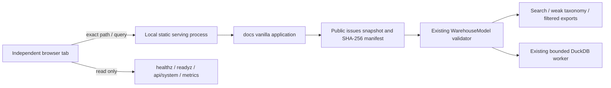

# Architecture

## Current system

The production data path remains the repository's Python and SQLite warehouse:

1. Committed GitHub search responses under `data/raw/` are the reproducible source inputs. Refreshing them is an explicit network operation; loading the saved set is offline.
2. `warehouse/load.py` normalizes those records into `data/warehouse.db`. `warehouse/checks.sql` validates schema, references, identities and known data-quality conditions.
3. `warehouse/export_site.py` writes the compact public `docs/data/issues.json` projection and an adjacent `manifest.json` with the snapshot SHA-256, row count, collection date and schema contract.
4. The vanilla JavaScript explorer fetches the public snapshot. Its views do not replace the normalized SQLite database.

The public projection includes issue title, repo, number, state, dates, comment count, sample, search-source flags, word flags and labels. It excludes issue bodies, usernames, email addresses and avatars. Hash verification confirms that downloaded bytes match the published manifest; it does not prove the authenticity of GitHub's source records or grant rights in their text.

## Browser workbench

The optional SQL route loads pinned DuckDB-Wasm assets from the same origin when the visitor runs SQL. A dedicated worker parses the request with DuckDB's SQL serializer, validates a single SELECT AST against the public `issues` projection and its function allowlist, and runs it with external access disabled. Query limits, AST bounds, result limits and worker deadlines bound this browser work.

Seeded splits order stable issue IDs using a versioned SHA-256 procedure. CSV and JSONL exports are built from real rows and reread before download. Parquet is written and reread in a separate export-only DuckDB database; that database receives generated values, never user SQL or a user-supplied path. Export rows and bytes are bounded. The first optional SQL use downloads the engine assets; the explorer's normal public snapshot view does not require DuckDB.

## Not deployed: possible AWS mapping

A future hosted research deployment could map a curated immutable snapshot to S3, describe its schema in Glue, restrict access with Lake Formation and run ad hoc scans through Athena. That is a proposed architecture only. This repository has no AWS account resources, buckets, Glue catalog, Lake Formation policy, Athena workgroup or hosted enterprise data pipeline. The optional local Python persistence API is separate from that proposed AWS architecture.

## Product entry and local saved work

The root and `/overview` open the canonical Overview. `/workbench`, `/reports`, and `/settings` reuse the existing analysis tools with persistent navigation. The former editorial landing remains at `#/`. Mounted Pages navigation keeps its app prefix and hash routes. `#/signup` and `#/login` unlock optional browser-local profiles; `#/saved` and `#/profile` manage saved work. `#/app` opens the catalogue; `#/app/explore`, `#/app/sql`, `#/app/manifest` and `#/app/methods` alias existing tool routes. Legacy explicit tool and scoped-filter URLs remain supported. All tools are free and guest accessible.

`local-profile.js` owns bounded profile and saved-work records. `product.js` owns product entry, native navigation disclosures, reduced-motion-aware previews and forms. The explorer adapter captures validated SQL/filter/snapshot context and clears pending search/SQL worker state on identity changes. SQL restoration never executes automatically, and previously shown results are invalidated. The static build uses no backend. The optional private Python server described below persists only explicitly selected work; no cloud resource or analytics was provisioned.

## Private imports and portable work

`docs/backlog.js` handles explicit CSV/JSON imports (2 MiB, 2,000 flat scalar rows) and bounded public GitHub imports (up to three 50-response pages). Mapping/preview precedes analysis. Original fields remain in memory until an explicit server Save or portable export; stable IDs combine source SHA-256 and row position, or a canonical public issue URL. Imported collections never join the published SQL projection. Category keywords are inferred candidates; severity/state remain supplied or Unknown. Markdown/CSV/print findings identify dataset, scope and denominators; CSV neutralizes formula prefixes while canonical input is retained.

Encrypted backup includes saved queries and only an explicitly selected private dataset. Restore validates/stages before an atomic local-profile commit; restored datasets stay in memory and SQL never executes automatically. The optional Supabase reference connector uses independent cloud auth, owner RLS, conditional revisions, conflict review and deletion tombstones. It ships unconfigured, with no hosted project or live cross-device proof. See ENCRYPTED_BACKUP.md and CLOUD_SYNC.md.

Browser-local profile namespaces are not same-origin security isolation. Existing saved records are not encrypted at rest; encryption protects exported backup files only.

## Direct local routes and trust boundary

The HTTP route allowlist serves the same application for the four canonical pages, `/`, and retained `/taxonomy`, `/export`, `/system` aliases. Unknown API/asset paths must stay 404. Pages retains legacy hash routing; only the local serving process has health endpoints. Filters remain in each tab's URL; no mutable server-side filter state exists.

The catalogue exporter now uses the same snapshot trust decision as the SQL adapter. Data and manifest fetches have ten-second deadlines; the existing byte limits and schema/hash validator remain in place. Taxonomy counts actual inclusion bases and original GitHub labels within the current selected rows, with overlapping counts and no inferred severity. Filtered CSV retains its formula-injection protection, while JSON retains source URLs, filters, the data hash and weak-label caveat.

System requests have five-second deadlines and show endpoint failure/retry states. Prometheus counters describe the HTTP serving process only; browser SQL/checker operations, data validity and historic throughput are not inferred from them. No AWS component was added for the direct routes.

## Optional private server persistence

The Python HTTP image adds SQLite WAL, Beaker server-side sessions and optional Argon2id accounts on a private UID10001 volume at `/var/lib/product`. The public source warehouse, datasets, research pipeline and DuckDB worker remain unchanged. Save current run explicitly persists real query/filter/seed metadata, actual result/split summaries, source hashes and any original selected private backlog artifact. Reconnection only announces pending changes. Private API responses are no-store and excluded from the public service worker. Snapshot restore creates a new owned workspace; logout revokes the durable session and invalidates private workers, imports, backups, cloud/share callbacks and DOM while retaining saved browser copies. Server-authenticated migration is the only automatic transfer of guest recovery into a new account namespace.

See [Server workspaces](SERVER_WORKSPACES.md) for the standalone Docker launch, exact3005 origin/secret/volume settings, ownership and CSRF checks, input/artifact/snapshot limits, and explicit recovery procedures. Browser profiles and encrypted portable backups remain independent of server accounts. The optional Supabase reference stays unconfigured; no AWS resources were added.
