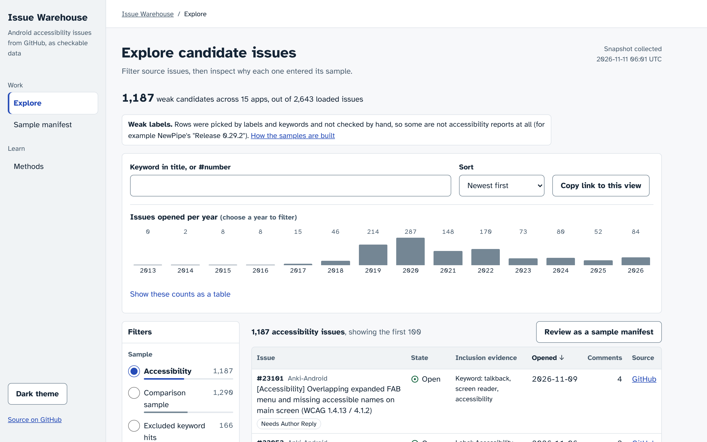

# a11y-issue-warehouse

[CI](https://github.com/anirudh763/a11y-issue-warehouse/actions)

A small, reproducible pipeline that collects accessibility-related GitHub issues from 15 open-source
Android apps on GitHub into a tested SQLite warehouse and answers a few questions about
them with SQL. It exists because my earlier accessibility work was done by hand (a lab
study of Play Store reviews, and `talkback-triage-pilot`, which hand-studied 75 reports
from two apps); this project is the data side of the same question at a larger size:
extract, load, check, analyse, with every step re-runnable offline from saved pages.

```
GitHub search API --extract.py--> data/raw/*.json.gz --load.py--> data/warehouse.db
                                                                   |-- checks.sql   (19 checks)
                                                                   |-- analysis/*.sql -> results/*.csv
                                                                   |-- classify.py   -> results/classifier_*.csv
                                                                   `-- export_site.py -> docs/ (explorer)
```

## Explorer

**Browse the issues:** https://anirudh763.github.io/a11y-issue-warehouse/ (GitHub Pages,
served from `docs/` on `main`)



A static page for accessibility researchers and Android maintainers. It opens on the
accessibility-issue sample (1,187 issues), newest first. Filter by app, accessibility evidence (the app's
accessibility label, or which search word the issue mentions), state, year opened and
GitHub label; switch to the comparison sample or the 166 excluded keyword hits; search
titles or `#number`. Filters are kept in the address, so a view can be shared, for example
`?app=signalapp/Signal-Android&state=open`. Choosing a title opens a panel with its labels,
dates, which queries returned it, which search words it contains, and a link to the issue
on GitHub. The page also charts the keyword-leakage result below, with the numbers in a
table.

The "accessibility" class is an accessibility-issue sample, not a set of bugs: weak labels
selected by labels and keywords, not hand-verified and not human ground truth. It includes
feature requests (for example AntennaPod#8145 carries both "Area: Accessibility" and
"Type: Feature request"); 504 of the 1,187 accessibility-sample issues carry a
feature-request or enhancement label. Some entries (release notes, test failures that
mention a11y) are only loosely about accessibility. The page says so above the table. No users were interviewed;
the explorer has not been validated with researchers or maintainers.

The page shows titles, labels, dates and links only: no author names, avatars or issue
bodies. Anything shaped like an email address in a title or label is replaced with
"[email removed]" in the export (one mozilla-mobile/fenix issue, #28360, has an address as
its whole title; the raw page in `data/raw/` still contains it).

Its data, `docs/data/issues.json` (426 KB, 127 KB gzipped), is written from the warehouse
by `make site`; CI rebuilds the warehouse and fails if the file is not a fresh export.

```
make load && make site           # data/raw -> data/warehouse.db -> docs/data/issues.json
make site-check                  # fails if docs/data/issues.json is stale
python3 -m http.server -d docs   # then open http://localhost:8000/

# browser test (Playwright, axe-core); one-time setup first:
cd tests/web && npm ci && npx playwright install chromium && cd ../..
make e2e
```

## Quick start

Needs Python 3 and `make` (run here with Python 3.13; CI on GitHub Actions uses 3.12). The raw pages are in the repository, so no network is needed.

```
pip install -r requirements.txt   # pytest, pandas, scikit-learn (pipeline itself is stdlib only)
make test      # unit tests, no network
make load      # data/raw/ -> data/warehouse.db
make check     # data-quality checks
make analyze   # analysis SQL, index benchmark, classifier -> results/
make data      # optional: re-fetch everything from GitHub (about 20 minutes, needs gh or GITHUB_TOKEN)
```

## Results

Every number below was produced in a shared cloud container on 2026-11-11 by the command
shown above it. Timings vary from machine to machine; counts do not, as long as
`data/raw/` is unchanged.

### Collection: `make data`

484 queries, 496 response pages, 3.7 MB gzipped (`du -sh data/raw`). The run took about
21 minutes at one request every 2.1 seconds. Queries per repository are in `DATA.md` and
`data/queries_run.json`.

No query in the real run had more than 1,000 results (the largest was 549), so date
splitting was not needed for this data. To see it work on a real query I ran `search_all`
once on `repo:AntennaPod/AntennaPod is:issue` (a one-off script, not in the repository):
61 requests, 8 date ranges, 4,934 issues returned, 4,934 distinct, equal to the
`total_count` GitHub reported.

### Load: `make load` (run twice)

```
first run:   pages_read 496   raw_items 3312   raw_distinct_issues 2643   rows_changed 12990   issues_total 2643
second run:  rows_changed 0
```

The first load took 1.5 s (`time make load`). 2,643 issues, 530 labels and 6,490
issue-label links; 2,392 issues are closed and 251 open; created between 2013-10-07 and
2026-11-09.

Incremental path, run once against copies of the data: `python3 -m warehouse.extract --since 2026-10-01`
ran 28 queries and returned 31 items; `python3 -m warehouse.load --incremental` skipped
all 3,343 items as not newer than the watermark and changed 0 rows, as expected a few
minutes after a full collection. The case where rows do change is covered by tests only.

### Checks: `make check`

```
19 checks run, 18 passed, 1 failed with a documented finding, 0 failed
```

**Data-quality finding.** The check `keyword_source_has_keyword_in_text` fails for 180
issues. They were returned by the keyword search
(`talkback OR "screen reader" OR accessibility OR a11y in:title,body`) but contain none of
those words. All 180 contain "screen" and "reader" as separate words, so GitHub did not
treat the quoted phrase as a phrase in this query; 109 are from WordPress-Android and 56
from woocommerce-android, which both have a feature called "Reader". The check is kept
as written and still reports the count on every run. The handling is explicit: the
`issue_class` view counts a keyword hit as an accessibility issue only if a search word is
really in its title or body. 166 of the 180 are therefore in no analysis; the other 14
were also drawn by the comparison sample and count as ordinary comparison issues. Without
this check about 13% of the "accessibility" class (180 of 1,367) would have been issues
about a blog reader.

### Analysis: `make analyze` (first step, `python3 analysis/run_analysis.py`)

2,477 classified issues: 1,187 accessibility (697 carry the repository's accessibility
label, 1,068 are confirmed keyword hits, 578 are both) and 1,290 comparison issues.
Full tables are in `results/`; `results/summary.md` has the per-repository counts.

| Question | Accessibility | Other | Source |
|---|---|---|---|
| Median days to close (closed issues, pooled) | 71.8 (n = 1,061) | 24.0 (n = 1,184) | `results/02_days_to_close.csv` |
| 90th-percentile days to close (pooled) | 598.3 | 476.5 | same |
| Still open one year after opening (pooled) | 32.0% (351 of 1,098) | 23.0% (277 of 1,206) | `results/03_open_after_one_year.csv` |

Per repository, the accessibility median is longer in 13 of 15 repositories and the
one-year-open share is higher in 12 of 15. The pooled rows are dominated by
mozilla-mobile/fenix (583 of the 1,187 accessibility-sample issues), so read the per-repository
rows rather than the pooled ones. Issues opened per year with running totals are in
`results/01_opened_per_year.csv`. The label seen most often with the accessibility label
is a bug or defect label in 5 of the 13 repositories that have such a label
(`results/04_label_cooccurrence.csv`, also in `results/summary.md`).

### Index: `python3 analysis/bench_index.py` (second step of `make analyze`)

The query is `analysis/05_comparison_date_match.sql`: for each accessibility issue, count
the comparison issues from the same repository created within 45 days of it. Median of 21
runs on a copy of the database, 2,643 rows in `issues`, SQLite 3.53.1.

Without `idx_issues_repo_created`: **3207.8 ms**

```
SEARCH o USING INDEX sqlite_autoindex_issues_1 (repo_id=?)
```

With `CREATE INDEX idx_issues_repo_created ON issues (repo_id, created_at)`: **61.3 ms** (52.3x faster)

```
SEARCH o USING COVERING INDEX idx_issues_repo_created (repo_id=? AND created_at>? AND created_at<?)
```

Before, SQLite could only use the `UNIQUE (repo_id, number)` index to narrow to the
repository and then read every issue row of that repository for each accessibility
issue. After, the date range is part of the index seek and the index covers the query.
The plan lines shown are the ones for the inner lookup; `bench_index.py` prints them.

### Classifier: `python3 analysis/classify.py` (third step of `make analyze`)

Task: predict accessibility issue or not from title and body. TF-IDF (1- and 2-grams) and
logistic regression, seed 0, leave-one-repository-out: each repository is scored by a model
trained on the other 14. Labels are never in the text. "Masked" removes `accessib*`,
`a11y`, `talkback`/`talk back` and `screen reader(s)` from the text before training and
scoring. 2,477 issues, 1,187 positive. F1 interval: 2,000 bootstrap resamples of issues, seed 0.

| System | Precision | Recall | F1 | F1 95% interval | Recall on the 114 positives with no search word |
|---|---|---|---|---|---|
| Keyword rule, raw text | 0.997 | 0.904 | 0.948 | 0.939 to 0.957 | 0.000 |
| Keyword rule, masked text | 0.000 | 0.000 | 0.000 | 0.000 to 0.000 | 0.000 |
| TF-IDF + logistic regression, raw text | 0.894 | 0.809 | 0.849 | 0.833 to 0.866 | 0.500 |
| TF-IDF + logistic regression, masked text | 0.783 | 0.731 | 0.756 | 0.736 to 0.776 | 0.711 |

Per held-out repository (`results/classifier_per_repo.csv`) the masked model's F1 ranges
from 0.400 (nextcloud/android, 76 issues) to 0.914 (thunderbird/thunderbird-android, 69 issues).

What this shows and does not show:

- The keyword rule's 0.948 is not an achievement. 1,068 of the 1,187 positives are
  positive *because* they contain one of those words, so the rule is being scored against
  its own definition. Its recall is below 1 only because of the label-only positives.
- The trained model does worse than the keyword rule on raw text. For this definition of
  the class, a model is not needed to reproduce it.
- The masked row is the informative one: with the defining words removed, a model trained
  on other repositories still reaches F1 0.756 on an unseen repository, so accessibility
  reports differ from other reports in more than those four words. It also finds 71.1% of
  the 114 issues that maintainers labelled as accessibility but that contain no search
  word, which a keyword search cannot find at all.
- It does not show that the model detects accessibility problems in general. The
  positives are whatever a label or four English words selected, the negatives are a
  date-matched sample that was not hand-checked, and nobody verified the labels.
- The interval treats issues as independent. Issues from one repository are not, and one
  repository supplies 1,149 of the 2,477 classified issues (46.4%), so the interval is narrower than it should be.

### Tests: `make test` and `make e2e`

```
make test   ->  73 passed
make e2e    ->  33 passed (+1 screenshot test that runs only with SCREENSHOTS=1)
```

`tests/test_export_site.py` checks that the explorer export has the same number of issues
per app and per sample as the database (2,643 total; 1,187 / 1,290 / 166), that the
committed `docs/data/issues.json` equals a fresh export of `data/raw/`, and that no body,
login, avatar URL or email address reaches it. `tests/web/explorer.test.mjs` opens the page
in Chromium and checks:

- for 8 filters set through the address (including a `#number` search), the count on screen
  equals a count from separate SQL (`tests/web/expected_count.py`);
- keyboard-only use of the search box, a filter, its chip and the issue panel;
- 375 px and 320 px widths and 200% zoom without page-level sideways scrolling;
- a clear message, not a blank page, when the data file is missing, not JSON, in the wrong
  format, or the network fails; and a "no issues match" state with a working Clear button;
- markup in titles and in the address stays text.

Accessibility: the explorer passes automated axe-core checks (WCAG 2.0, 2.1 and 2.2 A and AA
rules plus best practices) with 0 violations in light and dark themes, with the issue panel
open, at 375 px, 320 px and 200% zoom, and on the error page. It has no single-key
shortcuts. Manual screen-reader check not run.

### Applying the method of Aljedaani et al. (2022)

[`reproduction/`](reproduction/README.md) applies the W4A 2022 pipeline (description text,
preprocessing, feature hashing, four of its five classifiers, 10-fold CV) to this dataset.
It is not a reproduction of the paper's results: data, weak labels and class ratio differ.
On 2,452 issue bodies, 10-fold F1 is 0.735 to 0.865, below a rule that only checks for the
search words (0.907). With those words masked and each app held out, F1 is 0.551 to 0.653;
a shuffled-label control stays at AUC 0.489 to 0.523. Run with
`python3 reproduction/src/run_all.py`; tests with `python3 -m pytest -q reproduction/tests`.

### Security

Scanned with bandit, pip-audit, npm audit and semgrep (the semgrep registry was not
reachable from the build machine, so semgrep ran with a small local rule set for HTML
sinks, SQL built from strings, `shell=True` and workflow script injection); no
high-severity findings in the code. Changes made: the explorer writes all issue text with
`textContent` and sets a Content-Security-Policy without inline scripts; the CI workflow
has read-only token permissions, pins actions to commit SHAs and does not keep checkout
credentials; `hashlib.sha1` in `extract.py`, used only to name raw files, is marked
`usedforsecurity=False`, with a test that file names did not change.

## Design decisions

1. **Save raw pages, then load from disk.** Rejected: writing API responses straight into
   SQLite. With the pages saved, the load, the checks and CI run offline, the loader can
   be changed without spending rate limit again, and the 180-issue finding above could be
   investigated after the fact against exactly what GitHub returned.
2. **Upsert only when `updated_at` is newer.** Rejected: `INSERT OR REPLACE`. The same
   issue arrives in several pages (label query, keyword query, comparison sample). With
   REPLACE every reload rewrites every row and the last page read wins. With the guard,
   the newest copy wins in any page order and a reload changes zero rows, which makes
   `rows_changed` in `load_runs` a real signal.
3. **Class membership is derived in a view, not stored in a column.** Rejected: an
   `is_a11y` column written by the loader. The `issue_sources` table records only which
   query returned an issue. When the keyword results turned out to include unrelated
   issues, the fix was one view definition and no reload.
4. **Checks are plain SQL that return a count of bad rows.** Rejected: a data-quality
   framework. Nineteen SELECT statements and a 42-line runner are readable in a few
   minutes, and each one has a test that breaks a database and sees the check fire.
5. **Comparison issues are sampled per calendar month.** Rejected: one random-looking
   sample per repository. Time-to-close depends heavily on when an issue was filed
   (projects speed up, slow down, get archived), so each accessibility issue should have
   comparison issues from about the same time. `results/05_comparison_date_match.csv`
   measures this: 1,177 of 1,187 accessibility issues have a comparison issue within 45 days.
6. **Percentiles by nearest rank with window functions.** Rejected: SQLite's `median()`
   and `percentile()` functions, which are missing from the SQLite builds shipped with
   many Python installations. `ROW_NUMBER()` and integer arithmetic run everywhere.

## Limitations

- **The search index is not the issue tracker.** Only the search endpoint was reachable.
  It matches whole words, so "accessible" or "screen-reader" alone does not match, and it
  returned unrelated issues for the phrase (see the finding above). The counts are
  "issues this search found", not "all accessibility issues".
- **Label names were found by looking at the labels on keyword hits.** A repository whose
  accessibility label never appears on a keyword hit would be listed as having no label.
  duckduckgo/Android and home-assistant/android have none by this method.
- **One repository dominates.** mozilla-mobile/fenix contributes 583 of the 1,187 accessibility-sample issues (49.1%), 1,149 of the 2,477 classified issues (46.4%) and 1,159 of the 2,643 loaded issues (43.9%).
  It is archived (all of its issues are closed), which affects every pooled number.
- **Label-only positives.** 114 of the 1,187 accessibility-sample issues are labelled accessibility but have no search word in title or body;
  119 are labelled accessibility but are not a confirmed keyword hit (no search word, or the
  keyword query did not return them). A keyword search cannot find the 114. Numbers in this and the previous item come from
  `python3 analysis/label_shares.py`; `tests/test_label_shares.py` checks them.
- **The comparison sample is the oldest issues of each month**, not a random draw, and
  its size was set from the keyword results before the 180 unrelated hits were removed,
  so WordPress-Android and woocommerce-android have more comparison issues than
  accessibility issues (212 vs 129 and 122 vs 70).
- **Comparison issues are not verified negatives.** A few contain a search word inside a
  longer token (for example `AccessibilityService` in a stack trace); that is why the
  keyword rule's precision is 0.997 and not 1.
- **Days-to-close covers closed issues only**, and "closed" includes not-planned,
  duplicate and stale-bot closures. A short median can mean fast fixes or fast dismissal.
- **Issue state is a snapshot from 2026-11-11.** Reopen history is not available from
  the search endpoint.
- **The incremental path refreshes accessibility issues only**, and the watermark skip is
  only safe for pages fetched with `--since`. A full `make data && make load` is the
  fallback. The urllib transport was tried with one manual request, not a full run; the
  full run used `gh`.
- **Nothing was hand-labelled.** This project does not repeat the manual coding done in
  `talkback-triage-pilot`; it only prepares data on which that could be done.

## Repository layout

```
config.json            repositories, labels and the keyword query
warehouse/extract.py   transports, rate-limit retry, pagination, date splitting, raw pages
warehouse/load.py      idempotent upserts, incremental watermark, load_runs
warehouse/schema.sql   tables, index, issue_class view
warehouse/checks.sql   19 checks; warehouse/checks.py runs them
analysis/              five SQL analyses, run_analysis.py, bench_index.py, classify.py, label_shares.py
tests/                 73 tests on 13 recorded pages, hand-built databases and data/raw
data/raw/              496 saved response pages; data/queries_run.json lists the queries
results/               CSV output, summary.md, index_benchmark.md
warehouse/export_site.py  warehouse -> docs/data/issues.json for the explorer
docs/                  the explorer (static HTML, CSS, JS) served by GitHub Pages
tests/web/             Playwright and axe-core browser test of the explorer
```

`warehouse/` is 700 lines including SQL and the explorer export (`wc -l warehouse/*.py warehouse/*.sql`).

## How this was built

Built with AI assistance (Claude). Every number above comes from the commands shown.

Issue text belongs to its GitHub authors; see `DATA.md`. Code is MIT licensed. The
explorer uses the Atkinson Hyperlegible font (Braille Institute of America), licensed
under the SIL Open Font License 1.1; the licence text is in
`docs/atkinson-hyperlegible-OFL-1.1.txt`.
